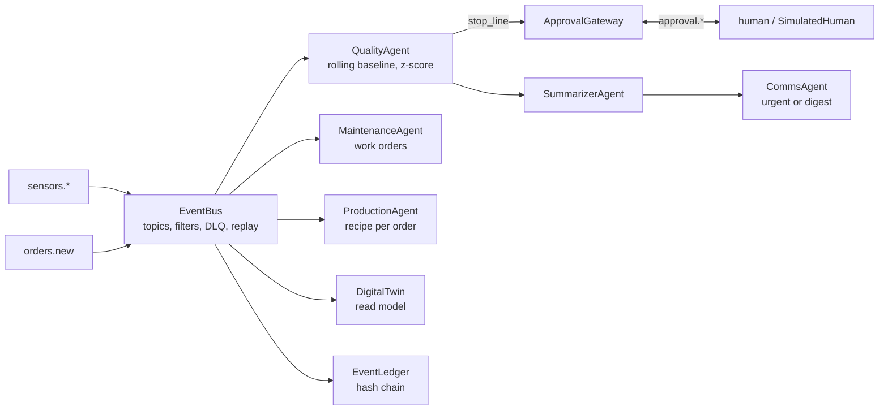

# Jagadish-event-driven-agents

[](https://github.com/jagadishmazure-jpg/Jagadish-event-driven-agents/actions/workflows/ci.yml)
[](https://github.com/jagadishmazure-jpg/Jagadish-event-driven-agents/actions/workflows/codeql.yml)


**Agents that react to events instead of requests: an in-process event bus with quality, maintenance and production agents for a simulated food plant, agent-to-agent choreography, human approval as an event, fallback agents and a hash-chained ledger.**

> Personal learning and portfolio project. Everything runs offline on synthetic,
> fictional data with no API keys. Nothing is deployed. Numbers in this README
> come from real runs and are re-checked by CI (`scripts/render_docs.py --check`).

## Recruiter summary

- Shows event-driven agent design: agents subscribe to topics, never call each other, and every cascade can be traced back to the sensor reading that started it.
- Real run on 1,800 synthetic readings: one batch quarantined (vibration z=45.8); line stops go to a human approver and are deferred when denied; ledger of 1,943 events verifies.
- Deterministic offline tests; CI with lint, CodeQL, gitleaks and documented-output drift checks.

## Purpose

Most agent demos answer requests. A plant does not wait for a request: a
temperature or vibration spike happens and something has to act now. This repo
shows the event-driven version: sensors publish, agents subscribe, and agents
publish their own events that other agents and people react to. My design notes
are in [docs/knowledge/](docs/knowledge/).

## Architecture



## How it works

1. Sensor readings are published on `sensors.<equipment>`.
2. `QualityAgent` keeps a rolling median and spread per sensor. A reading past
   the action threshold quarantines the batch; two sensors breaching together
   ask to stop the line. Every action cites the reading, the baseline and the z-score.
3. With an `ApprovalGateway` wired in, `stop_line` waits for `approval.granted`;
   denial or timeout publishes `quality.action_deferred` instead.
4. `SummarizerAgent` and `CommsAgent` react to quality actions (choreography, no
   orchestrator); critical items are paged on `comms.urgent`, the rest go to `comms.digest`.
5. `CascadeTracker.chain_for(root_id)` rebuilds the chain from any root reading.
6. `with_fallback` wraps a handler: on failure a safe degraded action is published
   and the event still lands in the dead-letter queue.
7. Every event is recorded in a hash-chained `EventLedger`.

Topics, schemas, publishers and subscribers: [docs/topics.md](docs/topics.md).

## Real code and output

```python
"""End-to-end run: overheat on mixer-01, human approval, a failing agent, an order."""
from collections import Counter

from eventagents import (
    ApprovalGateway,
    CascadeTracker,
    CommsAgent,
    DigitalTwin,
    EventBus,
    EventLedger,
    MaintenanceAgent,
    ProductionAgent,
    QualityAgent,
    SimulatedHuman,
    SummarizerAgent,
    gen_sensor_stream,
    inject_overheat,
    inject_vibration_spike,
)


def wire(policy):
    bus = EventBus()
    ledger = EventLedger()
    raw_publish = bus.publish

    def publish(topic, payload):
        event = raw_publish(topic, payload)
        ledger.record(event)
        return event

    bus.publish = publish
    SimulatedHuman(bus, policy=policy)
    agents = dict(
        quality=QualityAgent(bus, approval_gateway=ApprovalGateway(bus), approval_timeout=1.0),
        maintenance=MaintenanceAgent(bus),
        production=ProductionAgent(bus),
        twin=DigitalTwin(bus),
        tracker=CascadeTracker(bus),
    )
    SummarizerAgent(bus)
    CommsAgent(bus)
    return bus, ledger, agents


stream = gen_sensor_stream(n=200, seed=7)
stream = inject_overheat(stream, "mixer-01", start_seq=120)
stream = inject_vibration_spike(stream, "mixer-01", start_seq=120)

for policy in ("approve_quarantine_only", "approve_all"):
    bus, ledger, a = wire(policy)
    for r in stream:
        bus.publish(f"sensors.{r['equipment_id']}", r)
    q = a["quality"]
    print(f"--- approver policy: {policy}")
    print(f"sensor events: {len(stream)}")
    print("quality actions:", dict(Counter(x["action"] for x in q.actions)))
    print("deferred (approval denied):", len(q.deferred))
    first = next(x for x in q.actions if x["action"] == "quarantine_batch")
    print("first quarantine:", first["batch_id"], "|", first["reason"])
    print("work orders:", len(a["maintenance"].work_orders))
    print("pages (comms.urgent):", len(bus.history("comms.urgent")),
          "| digest:", len(bus.history("comms.digest")))
    chain = a["tracker"].chain_for(first["root_id"])
    print("cascade from the triggering reading:", " -> ".join(e["topic"] for e in chain))
    print("ledger events:", len(ledger.export_jsonl().splitlines()), "| chain verifies:", ledger.verify_chain())

bus, _, a = wire("approve_all")
bus.publish("orders.new", {"order_id": "ORD-1", "product": "sauce-base", "variant": "allergen-free",
                           "options": {"allergen_free": True, "extra_qa": True}})
recipe = a["production"].recipes[0]
print("--- order ORD-1 recipe steps:", recipe["steps"])
```

Output of `python examples/demo.py` (real run, re-checked in CI):

<!-- run: python examples/demo.py -->
```text
--- approver policy: approve_quarantine_only
sensor events: 1800
quality actions: {'quarantine_batch': 1}
deferred (approval denied): 46
first quarantine: batch-mixer-01-006 | quality deviation: vibration reading 15.0mm/s vs baseline 2.09mm/s (z=45.8)
work orders: 2
pages (comms.urgent): 0 | digest: 1
cascade from the triggering reading: sensors.mixer-01 -> quality.actions -> notify.summaries -> comms.digest
ledger events: 1943 | chain verifies: True
--- approver policy: approve_all
sensor events: 1800
quality actions: {'quarantine_batch': 1, 'stop_line': 46}
deferred (approval denied): 0
first quarantine: batch-mixer-01-006 | quality deviation: vibration reading 15.0mm/s vs baseline 2.09mm/s (z=45.8)
work orders: 2
pages (comms.urgent): 46 | digest: 1
cascade from the triggering reading: sensors.mixer-01 -> quality.actions -> notify.summaries -> comms.digest
ledger events: 2035 | chain verifies: True
--- order ORD-1 recipe steps: ['allergen_sanitize', 'stage_materials', 'mix', 'heat_treat', 'fill', 'seal', 'label', 'qa_sample', 'extended_qa']
```
<!-- /run -->

## How to run

```bash
git clone https://github.com/jagadishmazure-jpg/Jagadish-event-driven-agents.git
cd Jagadish-event-driven-agents
python -m pip install pytest      # no runtime dependencies
python -m pytest -q          # offline, no keys
python examples/demo.py
python scripts/render_docs.py --check   # documented output still matches
```

Test suite size (real collection, re-checked in CI):

<!-- run: python scripts/count_tests.py -->
```text
51 tests collected
```
<!-- /run -->

## Guardrails

- Line stops (the costly action) need human approval when a gateway is wired; quarantines stay automatic.
- Denied or timed-out approvals become `quality.action_deferred`, never a silent drop.
- A failing agent triggers a degraded safe action (defer plus manual-inspection work order) and a dead letter.
- Every action carries its evidence and a `root_id` back to the triggering reading.
- Hash-chained ledger of every event.

## Limitations

- In-process bus; no persistence or cross-process delivery.
- Each co-breaching reading raises a new `stop_line` request (46 in the demo run); production would de-duplicate per incident.
- The demo approver is `SimulatedHuman`; the gateway polls with a timeout rather than resuming asynchronously.
- Baselines are simple robust statistics, not trained models.
- No MCP or A2A connectivity here; see the related repos.

## Built vs planned

| Capability | Status | Where |
|---|---|---|
| Event bus with filters, DLQ and replay | Built | `eventagents/bus.py` |
| Quality, maintenance, production agents and digital twin | Built | `eventagents/*_agent.py`, `twin.py` |
| Choreography and cascade tracing | Built | `eventagents/choreography.py` |
| Human approval as events | Built | `eventagents/hitl.py` |
| Fallback agents | Built | `eventagents/fallback.py` |
| Hash-chained ledger | Built | `eventagents/audit.py` |
| Azure Event Hubs or Kafka backend, schema registry | Planned | docs/implementation-guide.md |
| Incident-level de-duplication of line stops | Planned | not started |

## Implementation guide

The step-by-step path from this offline build to an Azure deployment is in
[docs/implementation-guide.md](docs/implementation-guide.md). None of it has been
run; it is a plan.

## Related repositories

| Repo | How it relates |
|---|---|
| [Jagadish-food-ingredients-agentic-ai](https://github.com/jagadishmazure-jpg/Jagadish-food-ingredients-agentic-ai) | Same food-manufacturing domain with request-driven agents on Azure |
| [Jagadish-azure-ai-integration-platform](https://github.com/jagadishmazure-jpg/Jagadish-azure-ai-integration-platform) | MCP and A2A integration that this repo leaves out |
| [Jagadish-multi-agent-orchestration](https://github.com/jagadishmazure-jpg/Jagadish-multi-agent-orchestration) | Orchestrated (rather than choreographed) multi-agent patterns |
| [Jagadish-agentic-ai-model-risk](https://github.com/jagadishmazure-jpg/Jagadish-agentic-ai-model-risk) | Approval and audit controls for AI decisions |

## Documentation

- [Topic catalogue](docs/topics.md)
- [Design notes and diagrams](docs/knowledge/README.md)
- [Implementation guide (Azure)](docs/implementation-guide.md)
- [Interview points](docs/interview-points.md)
- [Security policy](SECURITY.md)

## Project layout

```
eventagents/
  bus.py                topics, filters, dead letters, replay
  sensors.py            synthetic stream + fault injection
  quality_agent.py      deviation detection, quarantine / stop line
  maintenance_agent.py  health scoring, work orders
  production_agent.py   recipe per order
  twin.py               event-sourced read model
  choreography.py       summariser, comms, cascade tracker
  hitl.py               approval gateway, simulated human
  fallback.py           degraded safe actions
  audit.py              hash-chained ledger
examples/demo.py        the run shown above
tests/                  offline pytest suite
```

## License

MIT, see [LICENSE](LICENSE). All data is synthetic; every organisation and person is fictional.
