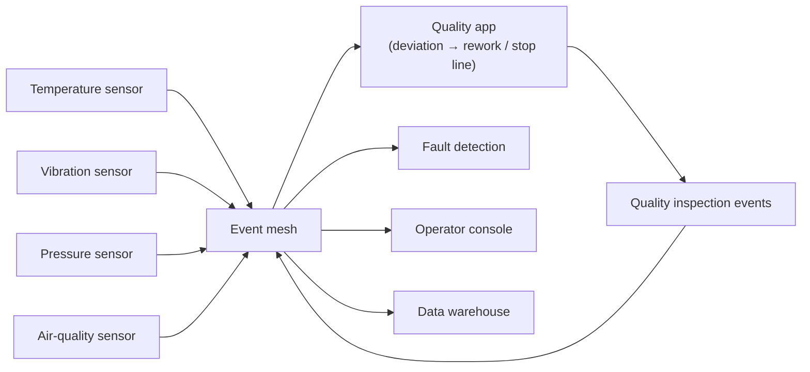
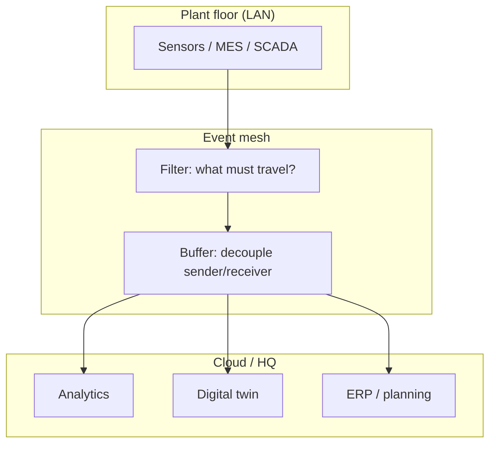
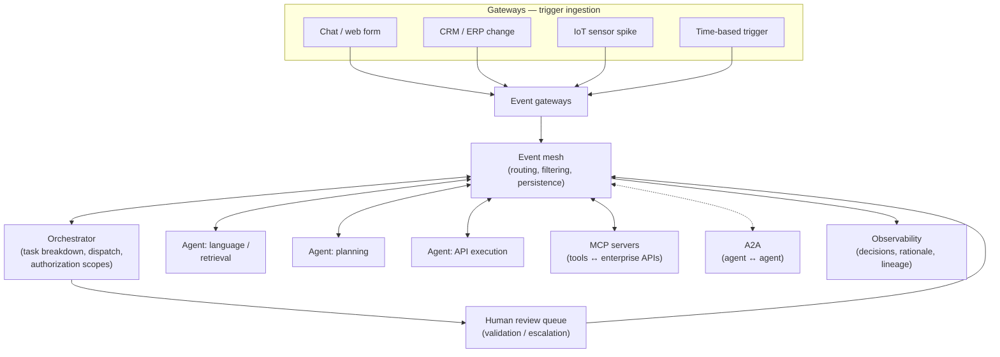
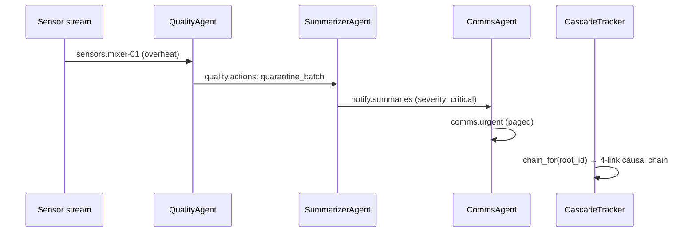
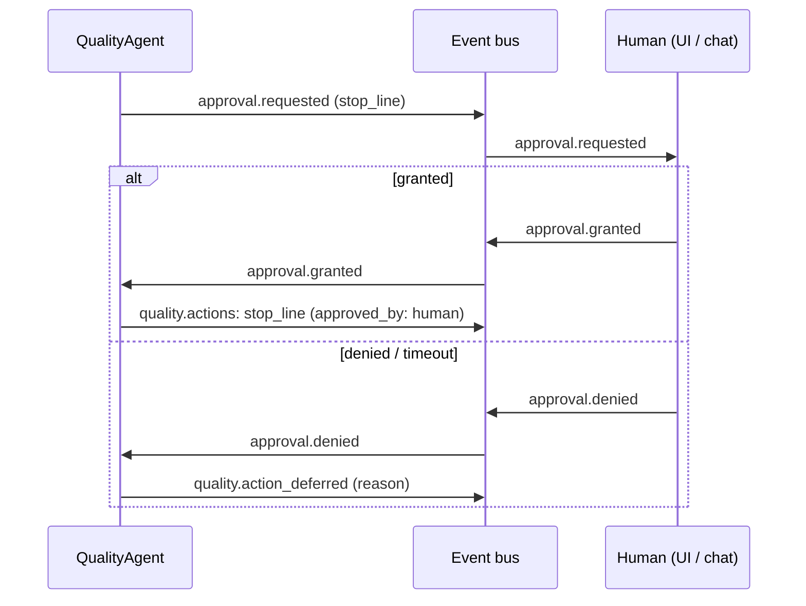
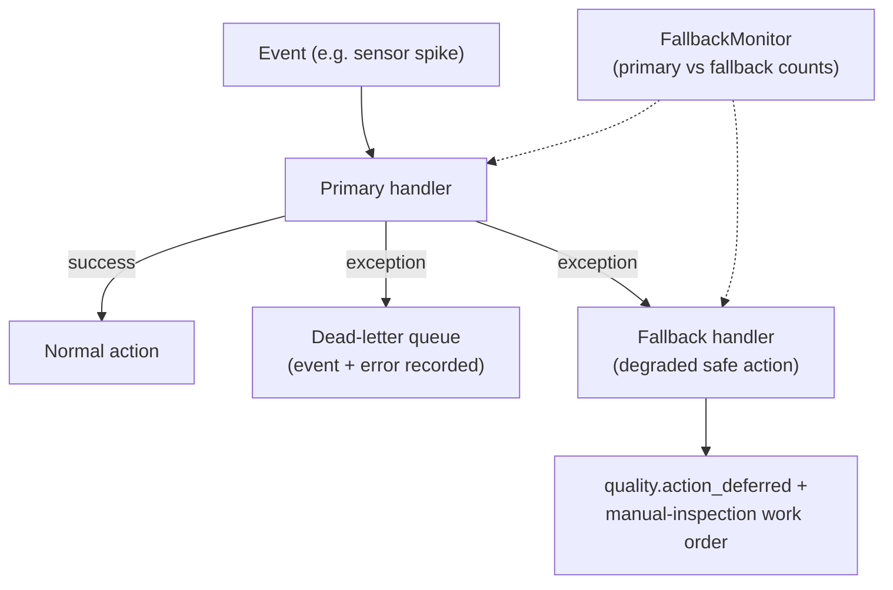
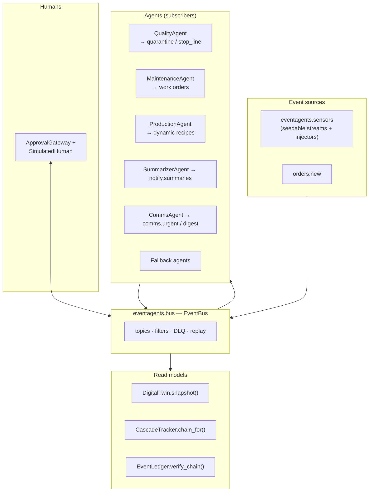

# 03 — Architecture diagrams

All diagrams are Mermaid (they render on GitHub). Sections 1 to 3 show general
event-driven patterns in my own drawing; sections 4 to 7 show this repo. The
notes in `01` and `02` explain them.

## 1. Smart factory event flow

Sensors publish; each consumer subscribes independently. New sensors or
new consumers join without changes on the other side.

## 2. Event mesh across the value chain

Only the needed subset crosses expensive WAN links — filter, buffer,
secure, observe.

## 3. Event-driven agentic AI reference architecture

A general shape for event-driven agents: gateways ingest triggers, the mesh
distributes, agents act, the orchestrator coordinates, humans stay in
the loop.

## 4. Choreography cascade (agent-to-agent, no orchestrator)

Agent-to-agent cascade in this repo: each agent
reacts to the previous agent's event. Implemented in
`eventagents/choreography.py`.

## 5. Human-in-the-loop as an event participant

Approvals are events; the human is just another subscriber/publisher.
Implemented in `eventagents/hitl.py`.

## 6. Fallback agents

When the primary handler fails, a degraded-but-safe action keeps the
factory protected. Implemented in `eventagents/fallback.py`.

## 7. How this repo maps to the architectures

